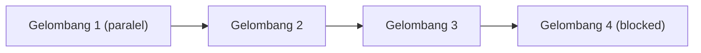

# Graf Eksekusi — Phase 3: Auth, Admin, Providers, Meta Model API

- **Task Slug:** `auth-admin-providers`
- **Date:** 1 Nov 2026
- **Spec:** `docs/specs/auth-admin-providers/2026-11-01-auth-admin-providers-spec.md`

## Kepemilikan jalur berkas

| Pemilik | Jalur yang dipegang | Tidak boleh disentuh |
|---|---|---|
| **Auth** | `app/api/auth/**`, `lib/server/auth.ts`, `lib/auth-client.ts`, `middleware.ts`, `db/migrations/0005_auth_tables.sql`, `db/migrations/0006_documents_user_id.sql`, `scripts/seed-admin.mjs` | `app/api/documents/**` core guard |
| **Admin** | `app/[locale]/admin/**`, `app/[locale]/(suara)/dokumen-saya/**`, `app/api/documents/**` (user_id linkage) | auth tables |
| **Providers** | `app/[locale]/admin/providers/**`, `lib/server/providers/**`, `app/api/providers/**`, `db/migrations/0007_providers.sql` | model client internals |
| **Model** | `lib/server/model/**`, `lib/server/quota/**` (cached-token counting), `app/api/model/**` | provider storage |
| **ASR (resume w03b)** | `lib/server/asr/**`, `app/api/asr/**`, `db/migrations/0005_asr_speaker.sql`, `app/[locale]/(suara)/rekam/**`, `i18n/locales/{en,id}.json`, `scripts/asr-realtime.mjs` | model client |
| **Infra** | `.github/workflows/**`, `Dockerfile`, `.env.example`, `docs/**` | kode aplikasi |

## Klasifikasi per tiket

| # | Tiket | depends_on | Kelas | Owned Paths | Conflicting Paths | Worker | Verifier | Acceptance |
|---|---|---|---|---|---|---|---|---|
| 01 | Auth login/register/middleware | None | **parallel** | `app/api/auth/**`, `lib/server/auth.ts`, `lib/auth-client.ts`, `middleware.ts`, `db/migrations/0005_auth_tables.sql`, `db/migrations/0006_documents_user_id.sql`, `scripts/seed-admin.mjs` | `middleware.ts` (next-intl), `app/[locale]/layout.tsx` | `senior-developer` | `test-automation-engineer` | register/login/Google + email confirm + protected routes + 401 |
| 02 | Admin dashboard + Dokumen saya + ownership | 01 | **sequential** | `app/[locale]/admin/**`, `app/[locale]/(suara)/dokumen-saya/**`, `app/api/documents/**` (user_id linkage) | `app/api/documents/**` (guard owner), admin layout with 03 | `senior-developer` | `test-automation-engineer` | admin gate, user list, enable/disable, all docs, usage/cost, per-user cap, customer list |
| 03 | Provider settings (admin) | 01 | **sequential** | `app/[locale]/admin/providers/**`, `lib/server/providers/**`, `app/api/providers/**`, `db/migrations/0007_providers.sql` | admin layout with 02, `app/api/providers/**` | `senior-developer` | `test-automation-engineer` | providers table, Meta Muse built-in, CRUD, encrypted+masked keys, test-connection |
| 04 | Meta Model API client | None | **parallel** | `lib/server/model/**`, `lib/server/quota/**` (cached tokens), `app/api/model/**` (token count) | `lib/server/quota/**` with 02 | `senior-developer` | `test-automation-engineer` | 3 protocols, structured output, recursive reject, reasoning, caching, token count |
| 05 | Meta Model API capabilities | 04 | **sequential** | `lib/server/model/**` (extend), `app/api/model/**` | same module as 04 (serialize) | `senior-developer` | `test-automation-engineer` | streaming, tools+search, grounding, files, images, video, SAM |
| 06 | OpenAI-compatible provider | 03, 04 | **sequential** | `lib/server/providers/openai-compat.ts`, `app/api/providers/**` (test-connection reuse) | `lib/server/providers/**` with 03 | `task` | `test-automation-engineer` | chat + structured output, optional speech, fallback to Meta |
| 07 | Meta ASR features | None | **parallel** | `lib/server/asr/**`, `app/api/asr/**`, `db/migrations/0005_asr_speaker.sql`, `app/[locale]/(suara)/rekam/**`, `i18n/locales/{en,id}.json`, `scripts/asr-realtime.mjs` | `i18n/locales/{en,id}.json` (shared) | `senior-developer` | `test-automation-engineer` | DIARIZATION, vocabulary, en+id hint, progress, realtime script |
| 08 | Deployment (public + live) | 01, 02, 03, 04 | **blocked** — menunggu izin tertulis pemilik untuk repo publik + deploy; jangan dimulai | `.github/workflows/**`, `Dockerfile`, `.env.example`, `docs/**` | none | `minimal-change-engineer` (+ owner) | owner | live URL reachable, repo public (owner approval), secret scan clean |

**Withdrawn ticket:** 09 — Lockfile — restore nodemailer. Withdrawn because its premise was false: `origin/main` 1c4b4e2 carries `nodemailer ^10.3.1` in both `package.json` and `package-lock.json`, proven with a clean `npm ci` + `npm run typecheck` on a detached worktree. It was read from the stale main checkout at `/home/ubuntu/repos/suara-lapangan` (commit `eb7dabd`, an ancestor) which has neither nodemailer nor `lib/server/email`. Do not re-add.

## Gelombang eksekusi

| Gelombang | Tiket paralel | Catatan |
|---|---|---|
| 1 | 01 · 04 · 07 | paralel (jev: parallel, confidence ≥0.97) |
| 2 | 02 · 03 · 05 | 05 setelah 04 selesai; 02/03 setelah 01 |
| 3 | 06 | setelah 03 + 04 |
| 4 | 08 | **blocked** — menunggu izin tertulis pemilik untuk repo publik dan deploy; tidak dimulai sampai izin tercatat |

Jalur kritis terpanjang: `01 → 02 → 08` dan `04 → 05`. Deadline 5 Nov 09:00 WIB.

## Konflik yang disengaja

| Tiket | Konflik | Penyelesaian |
|---|---|---|
| 02 vs 03 | admin layout | integrasi worker fan-in setelah keduanya selesai |
| 04 vs 05 | `lib/server/model/**` | serialize (05 setelah 04) |
| 07 vs semua | `i18n/locales/{en,id}.json` | serialize i18n edits lewat integrasi worker |

## Cek penasihat Jev (advisory, wajib — dijalankan 1 Nov 2026)

`jev_decide` (8 pertanyaan `choice`: parallel/sequential/blocked) dijalankan via `~/.omp/scripts/jev_helper.py` (input 1.181 token, biaya $0,00).

| Tiket | Manual (graf di atas) | Jev | Keyakinan | Selisih |
|---|---|---|---|---|
| 01 | parallel | parallel | 1,00 | — |
| 02 | sequential | sequential | 0,96 | — |
| 03 | sequential | sequential | 0,97 | — |
| 04 | parallel | parallel | 0,98 | — |
| 05 | sequential | sequential | 0,98 | — |
| 06 | sequential | sequential | 0,82 | — |
| 07 | parallel | parallel | 0,97 | — |
| 08 | blocked | blocked | 0,94 | — |

**Divergensi:** tidak ada. Semua klasifikasi Jev cocok dengan analisis manual.
