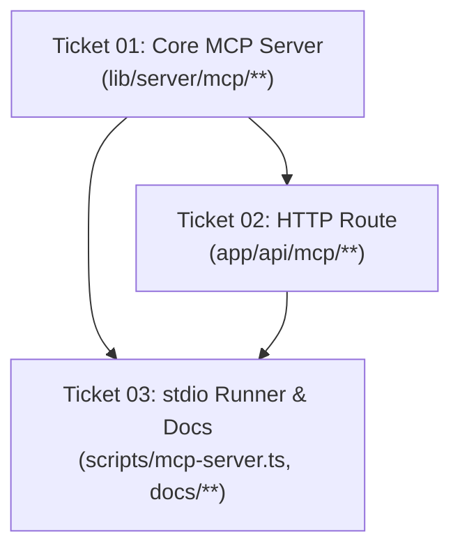

# Execution Graph: Suara Lapangan MCP Feature

- **Feature:** MCP Server Integration (Local AI & Web Muse Connector)
- **Task Slug:** `mcp-feature`
- **Date:** 2026-10-31

---

## Ticket Classifications

| Ticket | Title | Depends On | Execution Class | Owned Paths | Conflicting Paths | Worker Role | Verifier Role |
|---|---|---|---|---|---|---|---|
| **01** | Core MCP Server and Business Tool Definitions | None | `sequential` (Root) | `lib/server/mcp/**` | None | `senior-developer` | `test-automation-engineer` |
| **02** | Next.js App Router Streamable HTTP Endpoint | 01 | `sequential` | `app/api/mcp/**` | None | `backend-architect` | `api-tester` |
| **03** | Local stdio Runner & Web Muse Connector Guide | 01, 02 | `sequential` | `scripts/mcp-server.ts`, `docs/connectors/**` | None | `developer-tooling-engineer` | `reviewer` |

---

## Dependency Topology

---

## Analysis & Blast Radius

1. **Path Independence:**
   - None of the tickets touch existing ticket-owned paths (`app/api/documents/**`, `lib/server/guard/**`, `app/[locale]/(suara)/**`).
   - Ticket 01 defines the server factory.
   - Ticket 02 imports Ticket 01's factory and binds it to Next.js HTTP transport.
   - Ticket 03 imports Ticket 01's factory and binds it to stdio transport, then documents the connector.

2. **Execution Strategy:**
   - Because Ticket 02 and 03 depend on Ticket 01's exported `createMcpServer()`, the cleanest path without stubs or rebase churn is linear execution on a dedicated worktree branch `feature/mcp-server`.
