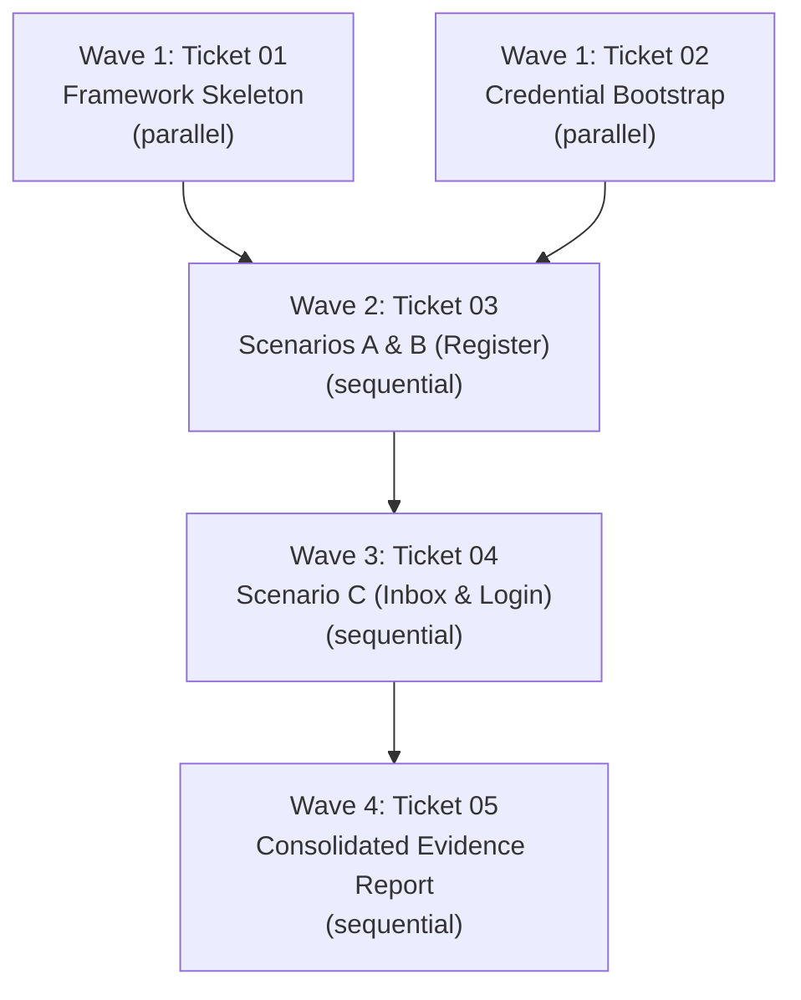

# Execution Graph: Register + Email Verification + Login E2E Suite (Phase 5)

**Source:** Approved Phase 3 Technical Specification (`~/repos/.scratch/register-login-e2e/spec/register-login-e2e-spec.md`) and 5 tracer-bullet tickets in `~/repos/.scratch/register-login-e2e/issues/`.

---

## 1. File Path Ownership & Conflict Isolation

| Role / Component | Owned File Paths (Exclusive) | Forbidden Paths |
|---|---|---|
| **E2E Core Framework (01)** | `~/repos/.scratch/register-login-e2e/e2e.config.ts`, `tests/smoke.e2e.ts`, `package.json`, `tsconfig.json` | `/home/ubuntu/repos/suara-lapangan*`, `/home/ubuntu/repos/e2e` |
| **Credential Manager (02)** | `~/repos/.scratch/register-login-e2e/lib/**` (`credentials.ts`, `accounts.ts`) | Application source, shared config |
| **Registration Runner (03)** | `~/repos/.scratch/register-login-e2e/tests/01-register-fresh.e2e.ts`, `tests/02-duplicate-rejection.e2e.ts` | Credential resolvers, app code |
| **Inbox & Auth Runner (04)** | `~/repos/.scratch/register-login-e2e/tests/03-inbox-verify-and-login.e2e.ts` | Application source, shared config |
| **Evidence Reporter (05)** | `~/repos/.scratch/register-login-e2e/scripts/generate-report.ts`, `.amp/in/artifacts/register-login-e2e-evidence.md` | Test execution suites |

**Conflict Analysis:** All ticket file paths are strictly partitioned inside `~/repos/.scratch/register-login-e2e/`. There are ZERO overlapping file paths between tickets. Because this entire suite runs within a single scratch directory and touches no application repository files, conflicting paths between tickets are empty (`None`).

---

## 2. Ticket Classification and Dependency Matrix

| Ticket | depends_on | Owned Paths | Conflicting Paths | Execution Class | Worker Role | Verifier Role | Acceptance Summary |
|---|---|---|---|---|---|---|---|
| **01**: Framework Skeleton | None | `e2e.config.ts`, `package.json`, `tsconfig.json`, `tests/smoke.e2e.ts` | None | **parallel** | `task` (E2E Dev) | `minimal-change-engineer` | Config targets :3100; smoke test loads `/en/register`; zero app repo diffs. |
| **02**: Credential Bootstrap | None | `lib/credentials.ts`, `lib/accounts.ts` | None | **parallel** | `task` (SecOps) | `minimal-change-engineer` | Akeyless CLI helper resolves handles; accounts matrix declared; zero secret echo. |
| **03**: Scenarios A & B | 01, 02 | `tests/01-register-fresh.e2e.ts`, `tests/02-duplicate-rejection.e2e.ts` | None | **sequential** | `senior-developer` | `test-automation-engineer` | Fresh register happy path succeeds; duplicate rejected with error; stop rule intact. |
| **04**: Scenario C & Login | 03 | `tests/03-inbox-verify-and-login.e2e.ts` | None | **sequential** | `senior-developer` | `test-automation-engineer` | Browser inspects generator.email; activation clicked; login +/- verified; anti-bot stops. |
| **05**: Evidence Report | 04 | `scripts/generate-report.ts`, `.amp/in/artifacts/register-login-e2e-evidence.md` | None | **sequential** | `task` (Reporter) | `code-reviewer` | All steps tabulated with exit codes; screenshots linked; zero git commits/pushes. |

---

## 3. Dependency Structure and Execution Waves

### Wave Breakdown

1. **Wave 1 (independent bootstrap, parallel)**:
   - Tickets **01** and **02** have no dependencies (`Blocked by: None`) and can execute concurrently.
   - 01 sets up test runner infrastructure; 02 builds Akeyless credential extraction and account matrix constants.
2. **Wave 2 (registration flow, sequential)**:
   - Ticket **03** requires both the test runner (01) and credentials (02).
   - Executes Scenario A (fresh registration) and Scenario B (duplicate rejection).
   - Must complete prior to Wave 3 because Scenario C depends on the fresh account registered in Scenario A.
3. **Wave 3 (verification and login, sequential)**:
   - Ticket **04** requires the account created by Ticket 03.
   - Drives browser navigation to `https://generator.email/ethan9b21b@ultrmigos.online`, extracts verification link, verifies account, and runs positive/negative login assertions.
   - Carries the hard anti-bot and delivery timeout circuit breakers.
4. **Wave 4 (evidence consolidation, sequential)**:
   - Ticket **05** runs after Ticket 04 finishes.
   - Compiles all test outputs, exit codes, and screenshot paths into `.amp/in/artifacts/register-login-e2e-evidence.md`.

### Single Worker Rationale
Although Tickets 01 and 02 are logically parallel, this task has a compact, tightly scoped domain residing entirely within a single scratch directory (`~/repos/.scratch/register-login-e2e/`). Executing the sequence with a **single worker agent** running sequentially through Wave 1 (01 -> 02) into Waves 2–4 is highly optimal. It avoids context thrashing, avoids multi-agent orchestration overhead, and guarantees deterministic cache reuse without risk of workspace race conditions.

---

## 4. Critical Path Analysis

The critical path spans:
$$\text{Ticket 01 (Skeleton)} \longrightarrow \text{Ticket 03 (Register)} \longrightarrow \text{Ticket 04 (Inbox + Login)} \longrightarrow \text{Ticket 05 (Evidence Report)}$$
Total sequential dependency depth: **4 steps** (with Ticket 02 resolving concurrently with or immediately alongside Ticket 01).

---

## 5. Mandatory Jev Advisory Check Status

Under Engineering Mode rules (Rule 6 and Phase 5 protocol), running `jev_decide` (15–25 `noul`/`choice` questions) to classify tickets into `parallel`/`sequential`/`blocked` is a mandatory advisory step.

**Status:**
- `jev_decide`: **UNAVAILABLE (MCP server not connected in this runtime)**.
- **Reporting Requirement:** In compliance with Rule 6, this advisory step is explicitly recorded rather than silently skipped.
- **Escalation to Gate 2:** The human operator must be flagged at Gate 2 to decide whether to:
  1. Accept the manual dependency classification presented in this graph.
  2. Or hold Gate 2 until the Jev MCP server is attached and run.
- **Advisory Variance Assessment:** The dependency edges in this 5-ticket graph are strictly governed by domain prerequisites (cannot verify an email before registering the account; cannot register before having the runner and credentials; cannot generate the final report before running the tests). The risk of divergence from an advisory model is near zero.
